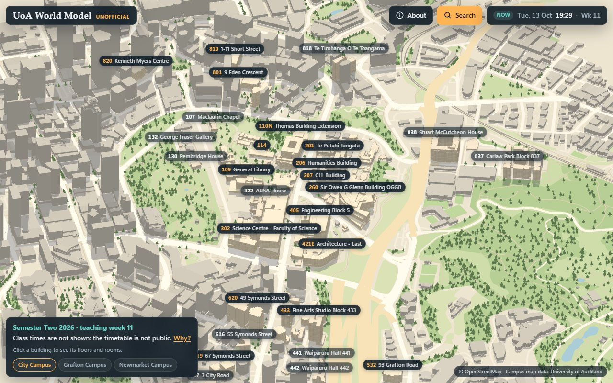
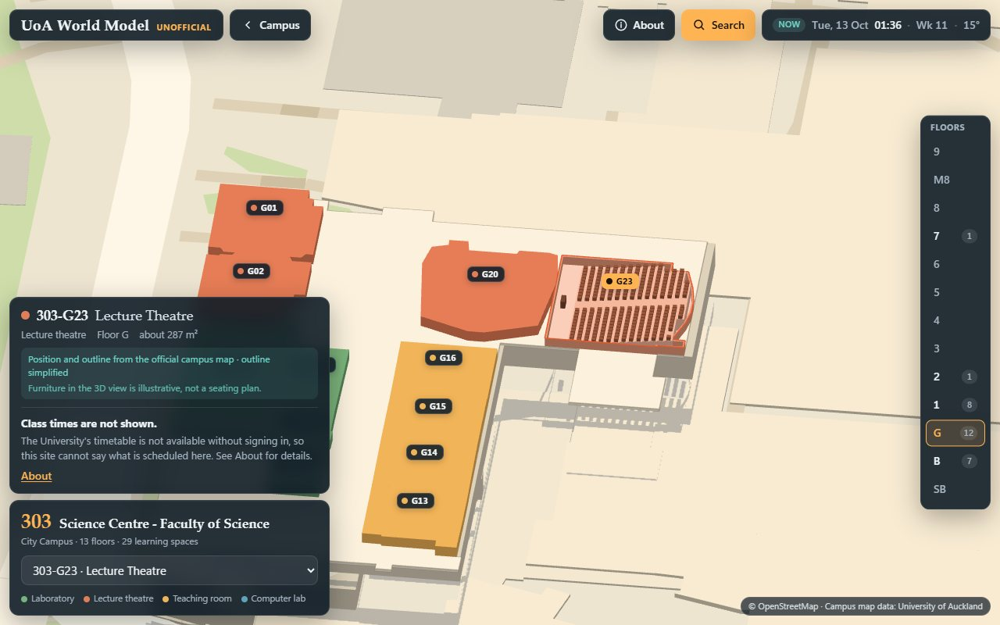
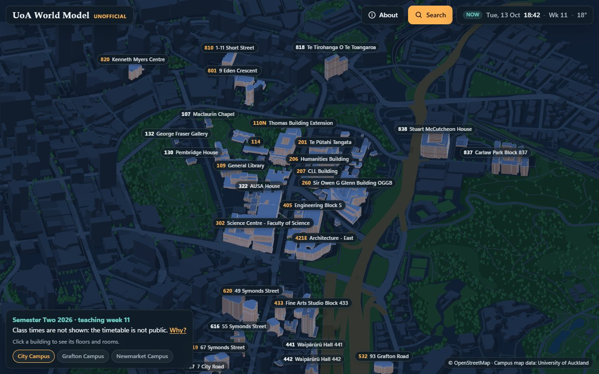

<div align="center">

# UoA World Model

An **unofficial**, student-made 3D map of University of Auckland buildings, floors and teaching rooms.

**Live site: https://campusworldmodel.com/uoa/**<br>
(also at https://pengqianhan.github.io/campus-world-model/)

[](https://github.com/pengqianhan/campus-world-model/actions/workflows/deploy.yml)
[](LICENSE)

[What's new](#whats-new) · [Changelog](CHANGELOG.md) · [Run it locally](#run-it-locally) ·
[Data sources](#data-sources-and-licences) · [Contributing](CONTRIBUTING.md)

</div>

> [!NOTE]
> It is not affiliated with, endorsed by or maintained by the University of Auckland, and uses no
> University logos or branding.



| Inside a building: floor G of the Science Centre | The same campus at night |
| --- | --- |
|  |  |

It is built to answer two questions a student actually has:

1. *Which building and floor is my room in?* Type a room code such as `303-G23`, a building name or
   number, and the camera flies to it. Click any building to step inside and browse floors and rooms.
2. *Is a class timetabled in this room right now?* The whole feature is built and tested, but the
   published site has **no class times yet**, because the University's timetable can no longer be read
   without signing in. See [Adding the class timetable](#adding-the-class-timetable). Nothing is made up
   to fill the gap.

## What's new

- **2026-10-15:** every campus on the map (194 buildings), standing on the ground's real heights;
  the real sun, the current cloud and rain, and trees that turn with the seasons; signs on stairs,
  lifts and toilets; About's note on the far campuses put right; the Southern Underpass under
  Symonds Street, no longer on it, from outside or opened.
- **2026-10-14:** every space on a floor shows its type, rooms stand as walls, and buildings gain
  roof colours, rims, storeys and windows; a flight to the Tsinghua World Model.
- **2026-10-13:** first release.

Everything, with its pull request, is in the [changelog](CHANGELOG.md).

<details>
<summary><strong>Contents</strong></summary>

- [What you get](#what-you-get)
- [Run it locally](#run-it-locally)
- [Updating the data snapshot](#updating-the-data-snapshot)
- [Adding the class timetable](#adding-the-class-timetable)
- [Adding a language](#adding-a-language)
- [Porting to another university](#porting-to-another-university)
- [Contributing](#contributing)
- [How it is put together](#how-it-is-put-together)
- [Data sources and licences](#data-sources-and-licences)
- [Known limitations](#known-limitations)
- [Inspiration](#inspiration)

</details>

## What you get

- **A rotatable miniature of every campus on the campus map:** 139 University buildings across the
  City, Grafton and Newmarket campuses, and 55 more at Tai Tokerau, Tai Tonga, Leigh, Waiheke, Ardmore
  and one Grafton building on Carrick Place, each on a base of OpenStreetMap streets, parks, trees and
  surrounding buildings. Each University building is stacked floor by floor from the campus map, so
  its podium, tower, setbacks and courtyards show. The city around it is drawn with the parts,
  heights and roof shapes OpenStreetMap holds, from house gables to the Sky Tower.
- **A cut-away view of every building:** pick a floor, see its learning spaces (lecture theatres,
  teaching rooms, labs, studios, study spaces) drawn from the outlines on the official campus map, set
  in the rest of the floor plan: 14,862 other spaces without names, each tinted by its type on the
  campus map (office, other lab, toilet, stairs or lift, service) and showing that type when pointed
  at or tapped. Stairs, lifts and toilets carry a sign.
- **Search** over 786 learning spaces, 4,668 further rooms (located as a point), 194 buildings and 251
  subject codes. Māori names match with or without macrons (`Maori` finds `Māori`).
- **"Now"** (Auckland time, daylight saving included) **and "Preview"** (any day and time), with the
  academic calendar: teaching week, breaks, study break, exams, public holidays.
- **The sun where it stands at the time shown,** so winter shadows are long and summer ones short; in
  Now mode, the current cloud, rain and fog from Open-Meteo; deciduous trees that turn and go bare
  with the seasons.
- **Every view is a link:** building, floor, room, time and language are all in the URL.
- **A phone layout.**
- **All interface text in one locale file,** ready for more languages.

## Run it locally

Requires Node 22.12 or newer (developed and built in CI on Node 24).

```bash
npm ci
npm run dev        # http://localhost:5273/campus-world-model/
```

Other commands:

| Command | What it does |
| --- | --- |
| `npm test` | Unit tests (room codes, floors, Auckland time and daylight saving, calendar, search, data checks) |
| `npm run typecheck` | TypeScript check |
| `npm run build` | Production build into `dist/` |
| `npm run preview` | Serve `dist/` at http://localhost:4273/campus-world-model/ |
| `npm run e2e` | Playwright tests against the preview build (run `npx playwright install chromium` once) |
| `npm run data:fetch` | Download any data snapshot that is not cached yet |
| `npm run data:build` | Rebuild `public/data/*.json` from the cached snapshots |

To test a deployed copy instead of a local build:

```bash
E2E_BASE_URL=https://pengqianhan.github.io/campus-world-model/ npm run e2e
```

The site is static. A merge into `main` runs `.github/workflows/deploy.yml`, which type-checks, runs
the unit and end-to-end tests, builds, and publishes to GitHub Pages only if all of that passed. The
Vite `base` is `/campus-world-model/`; set `BASE_PATH=/` to host at a domain root.

The same workflow publishes a second copy to Cloudflare Pages under `/uoa/`, with the files in
`cloudflare/` at the site root. That job runs only when the repository variable `CLOUDFLARE_PROJECT`
names a Pages project and the secrets `CLOUDFLARE_API_TOKEN` and `CLOUDFLARE_ACCOUNT_ID` are set, so
a fork deploys to GitHub Pages alone until it has them.

## Updating the data snapshot

Data is fetched once, cached as raw snapshots under `data/raw/`, and every later build reads the cache.
`data/sources.json` records the URL, fetch time, size and SHA-256 of each snapshot.

```bash
npm run data:fetch                               # fetches only what is missing
npx tsx scripts/fetch-mapsindoors.ts --refresh   # re-download the campus map (4 requests)
npx tsx scripts/fetch-osm.ts --refresh           # re-download OpenStreetMap context (1 request per area, 7)
npx tsx scripts/fetch-terrain.ts --refresh       # re-download the elevation tiles (29 at zoom 14)
npx tsx scripts/fetch-calendar.ts --refresh      # re-download the Calendar pages (3 requests)
npm run data:build                               # rebuild public/data from the snapshots
npm test                                         # the data consistency tests must still pass
```

Then commit `public/data/`, `data/sources.json` and (if refreshed) `data/raw/osm/`.

Rules the fetch scripts follow, and that any new one should too (`scripts/lib/snapshot.ts` enforces
them): only public pages that need no login; at most one request per second; each URL fetched once and
cached; an honest User-Agent that links to this repository. Raw snapshots of University data stay out
of the repository (`data/raw/` is gitignored); OpenStreetMap data is openly licensed and is committed.

When a new academic year starts, `data/academic-calendar.json` has to be re-transcribed by hand from
the University Calendar's key-dates page (the source URL is in the file).

## Adding the class timetable

The official source is the University's **Classes API v2**
(<https://developer.auckland.ac.nz/prd/documentation/api-classes-v2>). It returns, for each class, the
meeting patterns with day, start and end time, date range and room: exactly what this site needs. It
requires credentials that only someone with a University account can obtain, so this step is yours:

1. Get an **API key** for "Classes Api V2". Keys are not self-service: the Developer Portal dashboard
   (<https://developer.auckland.ac.nz/prd/dashboard>) sends you to the University's internal Athena
   tool, where the team that owns the API (the API document names Student Recruitment) approves the
   request. Say in the request that the class times will be republished on a public site.
   The portal's self-service OAuth credentials do not work for this API: a token is issued, but the
   class search still answers 401 (checked 2026-10-13).
2. Fetch and rebuild, with the key in the environment (never in a file that gets committed):

   ```bash
   UOA_API_KEY=... npx tsx scripts/fetch-classes.ts
   npm run data:build
   npm test && npm run build
   ```

3. Commit `public/data/` and push. Rooms then show what is timetabled at the selected time, buildings
   show a count of classes in progress, and courses become searchable.

> [!WARNING]
> `scripts/fetch-classes.ts` was written from the published OpenAPI document and has **not** been run
> against the live API (the project was built without a key), so the key header (`apikey`, which the
> API document does not spell out) or the paging parameters may need a small adjustment on first use.
> The part that turns API records into the published timetable (`scripts/lib/classes.ts`) is
> unit-tested, and the interface is tested end to end with a fixture timetable that exists only inside
> the test browser.

What the pipeline keeps for every class: course code and title, class type and section, day, times,
date range, the original location text, and how precisely it could be located (room, floor or
building). Records it cannot use are kept in an `exclusions` list with the reason. Staff names are
never read or published.

## Adding a language

1. Copy `src/i18n/locales/en.json` to `src/i18n/locales/<code>.json` (for example `mi.json`,
   `zh.json`).
2. Translate the values. Keep the keys and the `{placeholders}`. Set `_meta.name` to the language's own
   name; that is what the language menu shows.
3. That is all. The file is picked up automatically, the language appears in the menu in About, and
   `?lang=<code>` selects it. Missing keys fall back to English.

Names in the data are language-keyed too (`"name": { "en": "…" }`), so a translation of a building or
term name is one more key next to `en` (the calendar already carries a few `mi` names). The pipeline
writes only `en` today because that is all the sources provide.

`npm test` checks that every key used in the code exists in `en.json` and that components contain no
hard-coded interface text.

## Porting to another university

Most of the code carries over to another campus; the data pipeline and a handful of Auckland-specific
places do not. `.claude/skills/campus-world-model/` is a [Claude Code](https://claude.com/claude-code)
skill that takes an agent through a port: recon of the new school's public data, rebuilding the
pipeline, shipping the site and verifying it live. Fork or clone this repository, open it in Claude
Code and run `/campus-world-model <university, campus>`.

## Contributing

Reports and fixes are welcome: see [CONTRIBUTING.md](CONTRIBUTING.md). The rules every change keeps
and the checks it passes are written for people and for coding agents alike, in
[AGENTS.md](AGENTS.md) and [docs/standards.md](docs/standards.md).

## How it is put together

```text
scripts/            data pipeline (Node + TypeScript, run with tsx)
  lib/snapshot.ts     polite, cache-first fetcher
  fetch-*.ts          one script per source
  build-data.ts       snapshots -> public/data/*.json
data/
  sources.json        provenance of every snapshot
  academic-calendar.json   hand-transcribed key dates
  raw/                snapshots (gitignored except OpenStreetMap)
public/data/        published data: campus, context, rooms-index, subjects, calendar, schedule, meta,
                    and plans/ with one floor-plan file per building
src/shared/         pure logic shared by pipeline and app: geometry, room codes, Auckland time,
                    calendar, schedule, search
src/scene/          three.js scene
src/app/            state, URL, data loading, translations
src/ui/             Preact components and styles
src/i18n/locales/   interface text
tests/              unit tests (Vitest)
e2e/                browser tests (Playwright), numbered after the acceptance criteria
```

Accuracy is labelled wherever it matters. A room drawn with an outline comes from the campus map. A
room shown as a pin is known to the campus map by its code; the pin stands on the shape that the
floor plan draws for it, which is outlined. The shapes carry the campus map's type for each, in its
own words, and no code or name. A room that the map does not know is placed on a floor inferred from
its number and marked as inferred. A building's shape comes from the campus map's outline of each
floor, with floors that are alike within a twentieth of their area drawn as one block; its height is
an estimate of 3.6 m a floor, and its windows and roof rims are drawn by rule.

## Data sources and licences

| Source | Used for | Terms |
| --- | --- | --- |
| [University of Auckland campus maps](https://maps.auckland.ac.nz/) (the public map, served by MapsIndoors) | Buildings, floors, room codes, room types and positions | © University of Auckland. Only derived facts are published here: learning spaces with their names and simplified outlines; other searchable rooms as a code, floor and point; every other space as a simplified outline with the map's type for it and no code or name. Floors with student accommodation, childcare centres and single parking bays are left out, and a room the map marks as not searchable is never named. |
| [OpenStreetMap](https://www.openstreetmap.org/copyright) via the Overpass API | Surrounding buildings, streets, paths, parks, trees | © OpenStreetMap contributors, [Open Database License 1.0](https://opendatacommons.org/licenses/odbl/1-0/). The snapshot in `data/raw/osm/` and the derived `public/data/context.json` are under the same licence. |
| [University of Auckland Calendar 2026](https://www.auckland.ac.nz/en/about-us/about-the-university/the-university/official-publications/university-calendar/current-calendar.html) | Semester dates, breaks, holidays; list of subject codes | © University of Auckland. Dates and codes are quoted as facts with a link to the source. |
| [LINZ 8 m Digital Elevation Model (2012)](https://data.linz.govt.nz/layer/51768-nz-8m-digital-elevation-model-2012/), via the [AWS Terrain Tiles](https://registry.opendata.aws/terrain-tiles/) | The height of the ground | New Zealand terrain data © Land Information New Zealand and the New Zealand Government, [CC BY 3.0 NZ](https://creativecommons.org/licenses/by/3.0/nz/). The tiles also hold SRTM and GMTED2010 data (U.S. Geological Survey) and ETOPO1 (U.S. NOAA) at the coast. The tiles in `data/raw/terrain/` and the derived `public/data/terrain/` are under the same terms. |
| [Open-Meteo](https://open-meteo.com/) | Current weather in Auckland (temperature, cloud, rain, wind), fetched by the visitor's browser | [CC BY 4.0](https://open-meteo.com/en/licence) |

Snapshot dates are shown in the site's About panel and recorded in `public/data/meta.json`.

The **code** is under the MIT licence (see `LICENSE`). That licence does not cover the data above.

If you represent the University and would like something changed or removed, please open an issue.

## Known limitations

- **No class times** until a timetable snapshot is added (see above).
- **A timetabled class is not the same as an occupied room.**
- **Building heights are estimated and windows are drawn by rule.** The ground's heights come from
  the LINZ 8 m elevation model, drawn from contours: smooth, peaks a few metres low. A building stands
  at the ground under its middle, with a footing of up to 4 m on a slope.
- **Only learning spaces are named and can be selected.** The rest of a floor is shapes that show the
  campus map's type and nothing more; where the map's type says nothing ("Non Usable Area",
  "Nonasgn Rentable" and the like) the site says "Other area". Floors where people live and
  childcare centres are blank, and the furniture in a selected room is illustrative.
- **The campus map itself draws nothing on 98 floors of the 3D map** (most of them in halls of
  residence) and only a few spaces on 35 more. The floor list marks both and the building bar says
  so.
- **The campuses away from the centre** (Tai Tokerau, Tai Tonga, Leigh, Waiheke, Ardmore) each stand
  in a patch of surroundings a few hundred metres across, and the map jumps between them. Everything
  is drawn on one flat map centred on the City Campus, so shapes 125 km north are about 1.4% too
  narrow east to west. The sea is not drawn (OpenStreetMap's coastline is a line, not an area).
- **The academic calendar covers 2026 only.**

## Inspiration

This project was inspired by the
[Tsinghua World Model](https://tsinghua-world-model.pages.dev/?campus=1&classMode=live), an
independent student project that lets you walk through Tsinghua University's campus and find
courses and classrooms in it. The idea of a campus you can step into comes from there. The code,
models and data here were made separately; nothing is copied from that site.
